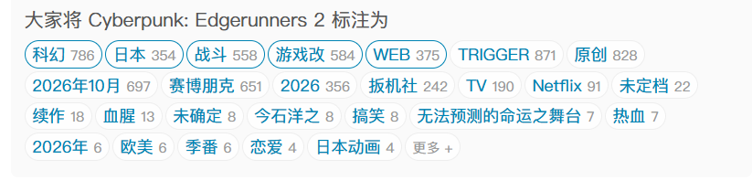

<https://bangumi.tv/subject/513878>
<!--more-->
# 战斗， 爽

搞不懂这动画有什么好喷的，它是角色动机不明？还是人物关系毫无铺垫？还是成长曲线模糊？还是剧情转折生硬？还是世界观战力崩坏？还是无意义升华了？

 剧透

还有内阁土味说唱，女主超绝联通，老冯骨灰封烟，静步摸背身当着所有人的面开不出枪，真是让人向往啊，赛博朋克的世界

## 一、逆天角色关系

> 1. 找维克和老冯商量
> 2. 给罗曼写信
> 3. 怀疑公司狗，但不要与他为敌

低棱关系包括但限于塔利亚和罗曼的关系，D和capri的关系，塔利亚与老冯的关系，老冯和金的关系，老冯和老爸的关系，奥米与D的关系，恭子和capri的关系。这期神了，讲了一个超级无敌大家庭群像剧，但是每个人都像从来没见过对方，然后突然就开始

## 二、想到哪写到哪

如果枪上挂着一只枪，那么总有一幕它会开出枪，但是这个b编剧和监督真的没有想过伏笔要怎么回收吗。

